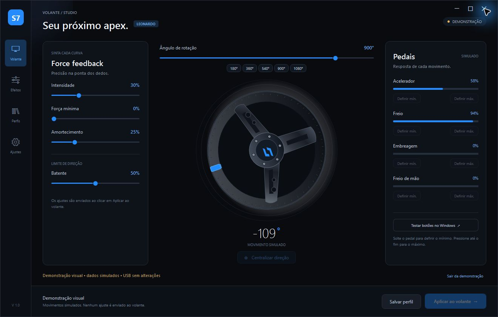

# Volante Studio

Aplicativo nativo para Windows que renova a interface de configuração do volante Arduino Leonardo com EMC Utility Lite. Fundo preto com iluminação difusa, controles azuis, volante vetorial animado e interface em português.



## Instalar (recomendado)

Baixe o **[instalador completo VolanteStudio-Setup-1.0.0.exe](https://github.com/samuel7kye/Firmware-Volante/raw/refs/heads/main/release/VolanteStudio-Setup-1.0.0.exe)** e siga as instruções em português. Ele inclui todas as bibliotecas necessárias; **não precisa instalar o EMCLite separadamente**.

O instalador cria uma entrada no menu Iniciar, oferece atalho na área de trabalho e permite desinstalar pelas Configurações do Windows. Instala para o usuário atual, sem solicitar senha de administrador. Perfis existentes são preservados em atualizações e na desinstalação.

1. Feche o EMCLite antigo, caso esteja aberto.
2. Abra o Volante Studio e conecte o Leonardo com o firmware compatível já gravado.
3. Confira o indicador de conexão, prepare os ajustes e clique em **Aplicar ao volante**.
4. Use **Perfis** para salvar combinações neste computador.

Sem o volante, clique em **Explorar demonstração**. Os movimentos são identificados como simulados e os envios USB ficam bloqueados.

O arquivo avulso `release/VolanteStudio.exe` é apenas a interface; para distribuir o projeto a outros alunos, use o arquivo **Setup**, que contém o pacote completo. Requer Windows 10/11 e .NET Framework 4.6.1 ou superior. O instalador ainda não possui assinatura digital de editor.

Para criar uma release, anexe o instalador e seu arquivo `.sha256`. Há um texto pronto e instruções de empacotamento em [installer/RELEASE.md](installer/RELEASE.md).

## O que está incluído

- Ângulo de 30° a 1080°, com atalhos para ângulos comuns.
- Intensidade, força mínima, amortecimento, batente, atrito e inércia.
- Leitura do volante, acelerador, freio, embreagem e freio de mão.
- Centralização e calibração de mínimo/máximo dos pedais.
- CPR do encoder, modo da ponte H e ativação das entradas opcionais.
- Perfis XML locais em `Data/Profiles`, sem envio automático ao carregar.
- Acesso ao painel de controladores do Windows para testar botões.
- Reconhecimento USB delegado ao componente original, sem drivers adicionais.
- Janela redimensionável com layout vetorial proporcional.

## Firmware e compatibilidade

Este repositório é o **aplicativo**, não um firmware novo. Não há gravador, comunicação com bootloader, mudança de descritor USB ou instalação de driver. O arquivo `EMCLite0932.hex` fornecido permanece intacto.

A comunicação usa as APIs públicas de `EMC.dll` e `EMCHid.dll` da instalação existente. Os jogos continuam recebendo o dispositivo HID diretamente do firmware do Leonardo; a nova interface não fica entre o volante e o jogo. A compatibilidade efetiva continua dependendo do firmware, da montagem e do jogo.

**Situação da validação:** build e 17 testes locais aprovados; navegação, demonstração, perfis e bloqueio de comandos sem dispositivo conferidos na aplicação aberta. A montagem dos comandos foi examinada em memória com a biblioteca original, isolada de hardware. **Leitura de eixos físicos, force feedback, reconexão e persistência no Leonardo ainda precisam de teste com o volante conectado.**

O aviso “comandos enviados” significa uma transferência USB bem-sucedida com o relatório, comando e valor esperados. Não representa confirmação de gravação em EEPROM. O aplicativo não inventa uma operação “salvar no dispositivo” que a API não fornece.

## Compilar

Requisitos: Windows com .NET Framework 4.6.1 ou superior e Windows PowerShell. Não exige Node, navegador, Visual Studio nem downloads de pacotes.

```powershell
powershell -NoProfile -ExecutionPolicy Bypass -File .\build.ps1 -Test
```

O resultado fica em `bin/VolanteStudio.exe`. Para usar uma cópia de backup do EMCLite:

```powershell
.\build.ps1 -OriginalPath 'C:\caminho\EMCLite-original' -Test
```

O script apenas lê a instalação original e copia suas bibliotecas para `bin/compat`. A ausência delas não impede compilar nem executar os testes de interface e validação; impede a comunicação real.

## Estrutura

| Local | Conteúdo |
|---|---|
| `src/MainWindow.xaml` | Layout, cores e controles |
| `src/WheelView.cs` | Desenho e rotação do volante |
| `src/App.cs` | Navegação, leitura, perfis e envio explícito |
| `src/EmcBridge.cs` | Integração com as bibliotecas originais |
| `src/TransferExpectation.cs` | Correspondência dos comprovantes de envio |
| `tests/Tests.cs` | Validação de escalas, perfis, interface e bloqueios |
| `docs/INTEROPERABILIDADE.md` | Mapeamento verificado da integração |
| `release/` | Executável da interface e configuração |

O instalador completo inclui as bibliotecas de terceiros. O firmware e os backups pessoais permanecem locais. Consulte [THIRD_PARTY.md](THIRD_PARTY.md).

